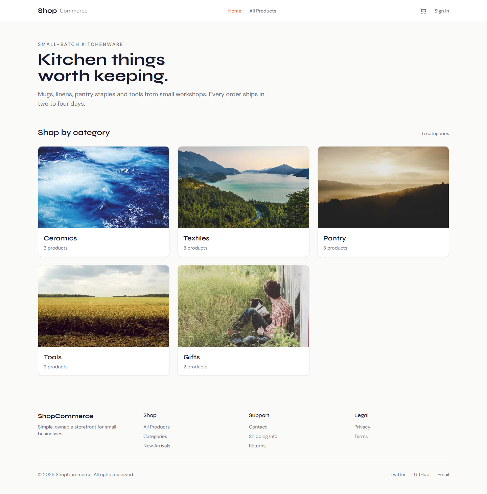

# ShopCommerce

A small-batch kitchenware store: category grid, product detail, account-only cart,
Stripe checkout, order confirmation, and an admin dashboard that changes order status.

Built as a portfolio piece. Real Postgres, real row-level security, real Stripe test-mode
payments — not a mock-up.



## Stack

| Piece | Choice | Why |
| --- | --- | --- |
| Framework | Next.js 14 (App Router), TypeScript | Server Components fetch the catalogue directly; Server Actions handle cart and checkout without an API layer |
| Styling | Tailwind CSS | Design tokens live in `tailwind.config.ts` and are taken from `design-anchor.md` |
| Data | Supabase (Postgres + RLS) | Auth and database in one place, with policies enforced in the database rather than the app |
| Payments | Stripe PaymentIntents + Payment Element | Embedded in the page, so no redirect away from the store |
| Tests | Playwright | Two viewports, no session required for the covered paths |

## What works

- **Catalogue** — 5 categories, 12 products, variants, all read from Postgres.
- **Cart** — one cart per signed-in user; quantity changes and removal.
- **Checkout** — shipping address, Payment Element, order created by a Stripe webhook.
- **Account** — order history with status badges.
- **Admin** — order table, inline status updates, guarded by `profiles.is_admin`.
- **States** — loading, empty, error and success on every screen, checked at 375 px and 1440 px.

### How checkout holds together

The interesting part, because it is where demos usually cheat:

1. `startCheckout` (a Server Action) creates the PaymentIntent server-side and writes the
   shipping address, email and totals into its **metadata** — the webhook has no session,
   so metadata is the only channel.
2. The browser confirms the payment with the Payment Element.
3. `/api/webhook/stripe` verifies the signature, then inserts the order **and** its line
   items from metadata. It is idempotent: a pre-check plus a unique partial index on
   `orders.stripe_payment_intent_id`, and duplicate inserts surface as `23505` rather than
   a second order.
4. The success page polls for the order, because the webhook can land seconds after the
   redirect.

## Docs

- [`specs/001-core-mvp/spec.md`](specs/001-core-mvp/spec.md) — problem, user, acceptance criteria
- [`specs/001-core-mvp/plan.md`](specs/001-core-mvp/plan.md) — architecture, data model, risks
- [`specs/001-core-mvp/tasks.md`](specs/001-core-mvp/tasks.md) — ordered tasks and every deviation
- [`specs/001-core-mvp/deploy.md`](specs/001-core-mvp/deploy.md) — deployment runbook
- [`design-anchor.md`](design-anchor.md) — palette, type, spacing, banned list

## Local setup

```bash
npm install
cp .env.local.example .env.local    # then fill in Supabase + Stripe keys
```

Apply `supabase/migrations/*.sql` in order, then `supabase/seed.sql`. Both are idempotent.

```bash
npm run dev
```

Stripe webhooks locally need the CLI, with the event list that matches this flow:

```bash
stripe listen --forward-to localhost:3000/api/webhook/stripe --events payment_intent.succeeded
```

The `whsec_` printed by `stripe listen` is per-listener. It is **not** the same as the
secret from a dashboard endpoint, and it changes if you re-run `stripe login`.

## Verify

```bash
npm run typecheck
npm run lint
npm run build
npm run test:e2e        # 18 tests across 1440 and 375
```

`test:e2e` needs `npx playwright install chromium` once. It reuses a running dev server.

## Deploy

See [`specs/001-core-mvp/deploy.md`](specs/001-core-mvp/deploy.md). Short version: Vercel,
Supabase URL configuration, and a **new** Stripe webhook endpoint — the CLI secret will
not work in production.

## Scope, honestly

Deliberately absent: inventory tracking, discount codes, email notifications, guest
checkout, reviews, wishlist, i18n, analytics, subscriptions.

Two things to know before treating this as production-ready:

- **Stripe is in test mode.** Card `4242 4242 4242 4242` succeeds; no money moves.
- **Product photography is Unsplash stand-in imagery**, chosen to match each product but
  not shot for it. Two of the photos show third-party brand labels (the coffee bag and the
  chilli salt jar). Replace them with your own before this fronts a real shop.
